本指南汇总了 Firefly 博客的所有核心功能和使用方法。无论你是初次使用还是需要查阅特定功能，都可以在这里找到答案。

---

## 目录

- [第一部分：入门指南](#第一部分入门指南)
  - [1.1 项目概述](#11-项目概述)
  - [1.2 Front-matter 配置](#12-front-matter-配置)
  - [1.3 文章文件组织](#13-文章文件组织)
  - [1.4 自定义文章 URL (Slug)](#14-自定义文章-url-slug)
  - [1.5 草稿管理](#15-草稿管理)
- [第二部分：Markdown 写作](#第二部分markdown-写作)
  - [2.1 Markdown 基础教程](#21-markdown-基础教程)
- [第三部分：高级特性](#第三部分高级特性)
  - [3.1 代码块高级特性](#31-代码块高级特性)
  - [3.2 Markdown 扩展功能](#32-markdown-扩展功能)
  - [3.3 Mermaid 图表](#33-mermaid-图表)
  - [3.4 PlantUML 图表](#34-plantuml-图表)
  - [3.5 KaTeX 数学公式](#35-katex-数学公式)
  - [3.6 MDX 格式](#36-mdx-格式)
  - [3.7 Wiki Link 内部链接](#37-wiki-link-内部链接)
  - [3.8 文章加密](#38-文章加密)
  - [3.9 嵌入视频](#39-嵌入视频)
- [第四部分：布局与配置](#第四部分布局与配置)
  - [4.1 布局系统详解](#41-布局系统详解)

---

## 第一部分：入门指南

### 1.1 项目概述

**Firefly** 是一款基于 Astro 框架和 Fuwari 模板开发的清新美观且现代化个人博客主题模板，专为技术爱好者和内容创作者设计。该主题融合了现代 Web 技术栈，提供了丰富的功能模块和高度可定制的界面，让您能够轻松打造出专业且美观的个人博客网站。

**项目地址**

- 在线预览：[Firefly - Demo site](https://firefly.cuteleaf.cn/)
- 作者博客：[https://blog.cuteleaf.cn](https://blog.cuteleaf.cn/)
- 使用文档：[https://docs-firefly.cuteleaf.cn](https://docs-firefly.cuteleaf.cn/)
- 开源地址：[https://github.com/CuteLeaf/Firefly](https://github.com/CuteLeaf/Firefly)
- 上游项目：[https://github.com/saicaca/fuwari](https://github.com/saicaca/fuwari)

::github{repo="CuteLeaf/Firefly"}

::github{repo="saicaca/fuwari"}


**技术架构**

- **静态站点生成**：基于 Astro，提供极快的加载速度和优秀的 SEO 优化
- **TypeScript 支持**：完整的类型安全，提升开发体验和代码质量
- **响应式设计**：使用 Tailwind CSS 构建，完美适配桌面端和移动端
- **组件化开发**：支持 Astro、Svelte 组件，灵活可扩展

---

### 1.2 Front-matter 配置

这个博客模板是基于 [Astro](https://astro.build/) 构建的。对于本指南中未提及的内容，您可以在 [Astro 文档](https://docs.astro.build/) 中找到答案。

文章的 Front-matter 示例：

```yaml
---
title: 我的第一篇博客文章
published: 2023-09-09
description: 这是我新 Astro 博客的第一篇文章。
image: ./cover.jpg
tags: [前端, 开发]
category: 前端开发
draft: false
---
```

| 属性 | 描述 |
|------|------|
| `title` | 文章标题。 |
| `published` | 文章发布日期。 |
| `updated` | 文章更新日期。如果未设置，将默认使用发布日期。 |
| `pinned` | 是否将此文章置顶在文章列表顶部。 |
| `description` | 文章的简短描述。显示在首页上。 |
| `image` | 文章封面图片路径。<br/>1. 以 `http://` 或 `https://` 开头：使用网络图片<br/>2. 以 `/` 开头：`public` 目录中的图片<br/>3. 不带任何前缀：相对于 markdown 文件的路径 |
| `tags` | 文章标签。 |
| `category` | 文章分类。 |
| `lang` | 文章语言代码（如 `zh-CN`）。仅当文章语言与站点默认语言不同时设置。 |
| `licenseName` | 文章内容的许可证名称。 |
| `licenseUrl` | 文章内容的许可证链接。 |
| `author` | 文章作者。 |
| `sourceLink` | 文章内容的来源链接或参考。 |
| `draft` | 如果这篇文章仍是草稿，则不会显示。 |
| `comment` | 是否启用此文章的评论功能。默认为 `true`。 |
| `slug` | 自定义文章 URL 路径。如果不设置，将使用文件名作为 URL。 |
| `password` | 文章密码。设置后文章内容将被 AES-256-GCM 加密，访客需输入密码才能查看。 |
| `passwordHint` | 密码提示。显示在密码输入框上方，帮助访客回忆密码。 |

---

### 1.3 文章文件组织

您的文章文件应放置在 `src/content/posts/` 目录中。您也可以创建子目录来更好地组织您的文章和资源。

```
src/content/posts/
├── post-1.md
└── post-2/
    ├── cover.png
    └── index.md
```

---

### 1.4 自定义文章 URL (Slug)

Slug 是文章 URL 路径的自定义部分。如果不设置 slug，系统将使用文件名作为 URL。

#### 示例 1：使用文件名作为 URL

```yaml
---
title: 我的第一篇博客文章
published: 2023-09-09
---
```

文件：`src/content/posts/my-first-blog-post.md`
URL：`/posts/my-first-blog-post`

#### 示例 2：自定义 Slug

```yaml
---
title: 我的第一篇博客文章
published: 2023-09-09
slug: hello-world
---
```

文件：`src/content/posts/my-first-blog-post.md`
URL：`/posts/hello-world`

#### 示例 3：中文文件名使用 Slug

```yaml
---
title: 如何使用 Firefly 博客主题
published: 2023-09-09
slug: how-to-use-firefly-blog-theme
---
```

文件：`src/content/posts/如何使用Firefly博客主题.md`
URL：`/posts/how-to-use-firefly-blog-theme`

#### Slug 使用建议

1. **使用英文和连字符**：`my-awesome-post` 而不是 `my awesome post`
2. **保持简洁**：避免过长的 slug
3. **具有描述性**：让 URL 能够反映文章内容
4. **避免特殊字符**：只使用字母、数字和连字符
5. **保持一致性**：在整个博客中使用相似的命名模式

> [!NOTE]
> Slug 一旦设置并发布，建议不要随意更改，以免影响 SEO 和已存在的链接。如果多个文章使用相同的 slug，后面的文章会覆盖前面的。Slug 会自动转换为小写。

---

### 1.5 草稿管理

将文章的 `draft` 设为 `true`，该文章在**生产环境**中不会显示（开发环境中所有文章可见）。

```yaml
---
title: 草稿示例
published: 2024-01-11
tags: [Markdown, 博客, 演示]
category: 示例
draft: true
---
```

当文章准备发布时，将 `draft` 更新为 `false` 即可。

---

## 第二部分：Markdown 写作

### 2.1 Markdown 基础教程

本文档汇总了核心 Markdown 语法与常见扩展（GFM）。

- [块级元素](#块级元素)
    - [段落与换行](#段落与换行)
    - [标题](#标题)
    - [引用](#引用)
    - [列表](#列表)
    - [代码块](#代码块)
    - [分割线](#分割线)
    - [表格](#表格)
- [内联元素](#内联元素)
    - [链接](#链接)
    - [强调](#强调)
    - [行内代码](#行内代码)
    - [图片](#图片)
    - [删除线](#删除线)
- [杂项](#杂项)
    - [自动链接](#自动链接)
    - [反斜杠转义](#反斜杠转义)
- [内联 HTML](#内联-html)

<a id="块级元素"></a>

#### 块级元素

<a id="段落与换行"></a>

##### 段落与换行

**段落**

HTML 标签：`<p>`

使用一个或多个空行分隔段落。（仅包含**空格**或**制表符**的行也视为空行。）

```
This will be
inline.

This is second paragraph.
```

效果：

This will be
inline.

This is second paragraph.

**换行**

HTML 标签：`<br />`

在行末添加**两个或更多空格**来产生换行。

```
This will be not  
inline.
```

<a id="标题"></a>

##### 标题

Markdown 支持两种标题样式：Setext 与 atx。

**Setext 风格**

使用**等号 (=)** 表示 `<h1>`、使用**短横线 (-)** 表示 `<h2>`，数量不限，作为"下划线"。

```
This is an H1
=============
This is an H2
-------------
```

**atx 风格**

在行首使用 1-6 个**井号 (#)**，对应 `<h1>` 至 `<h6>`。

```
# This is an H1
## This is an H2
###### This is an H6
```

可选：你可以在行尾"闭合" atx 标题。末尾的井号数量不必与开头一致。

```
# This is an H1 #
## This is an H2 ##
### This is an H3 ######
```

<a id="引用"></a>

##### 引用

HTML 标签：`<blockquote>`

Markdown 使用邮件风格的 **>** 作为引用符号。若手动换行并在每行前加 >，显示效果最佳。

```
> This is a blockquote with two paragraphs. Lorem ipsum dolor sit amet,
> consectetuer adipiscing elit. Aliquam hendrerit mi posuere lectus.
> Vestibulum enim wisi, viverra nec, fringilla in, laoreet vitae, risus.
>
> Donec sit amet nisl. Aliquam semper ipsum sit amet velit. Suspendisse
> id sem consectetuer libero luctus adipiscing.
```

Markdown 允许"偷懒"：在一个硬换行段落中，只在第一行前加 > 即可。

引用可以嵌套（引用中的引用），通过增加 > 层级实现。

```
> This is the first level of quoting.
>
> > This is nested blockquote.
>
> Back to the first level.
```

引用内可包含其他 Markdown 元素，包括标题、列表与代码块。

```
> ## This is a header.
>
> 1.  This is the first list item.
> 2.  This is the second list item.
>
> Here's some example code:
>
>     return shell_exec("echo $input | $markdown_script");
```

<a id="列表"></a>

##### 列表

Markdown 支持有序（数字）与无序（圆点）列表。

**无序列表**

HTML 标签：`<ul>`。无序列表可使用 **星号 (\*)**、**加号 (+)** 或 **短横线 (-)**。

```
*   Red
*   Green
*   Blue
```

等价于 `+   Red` 或 `-   Red`。

**有序列表**

HTML 标签：`<ol>`。有序列表使用数字加英文句点：

```
1.  Bird
2.  McHale
3.  Parish
```

**列表中的缩进内容**

在列表项内放置引用，需要将 > 符号整体缩进：

```
*   A list item with a blockquote:

    > This is a blockquote
    > inside a list item.
```

在列表项内放置代码块，需要缩进两层——**8 个空格**或**两个 Tab**：

```
*   A list item with a code block:

        <code goes here>
```

**嵌套列表**

```
* A
  * A1
  * A2
* B
* C
```

<a id="代码块"></a>

##### 代码块

HTML 标签：`<pre>`

将代码块中的每行缩进至少**4 个空格**或**1 个制表符**。

```
This is a normal paragraph:

    This is a code block.
```

代码块会一直持续，直到遇到未缩进的行（或文末）。在代码块内，**与号 (&)** 和尖括号 **(< >)** 会自动转为 HTML 实体。

**围栏代码块**

使用成对的反引号围起来（如下所示），就不需要四空格缩进了。

````
Here's an example:

```
function test() {
  console.log("notice the blank line before this function?");
}
```
````

**语法高亮**

在围栏代码块后添加可选的语言标识，即可启用语法高亮。

````
```ruby
require 'redcarpet'
markdown = Redcarpet.new("Hello World!")
puts markdown.to_html
```
````

<a id="分割线"></a>

##### 分割线（水平线）

HTML 标签：`<hr />`

一行中放置**三个或以上的短横线 (-)、星号 (\*) 或下划线 (\_)**。符号之间允许有空格。

```
* * *
***
*****
- - -
```

<a id="表格"></a>

##### 表格

HTML 标签：`<table>`

用**竖线 (|)** 分隔列，用**短横线 (-)** 分隔表头，使用**冒号 (:)** 指定对齐方式。

```
| Left | Center | Right |
|:-----|:------:|------:|
|aaa   |bbb     |ccc    |
|ddd   |eee     |fff    |

 A | B
---|---
123|456
```

效果：

| Left | Center | Right |
| :--- | :----: | ----: |
| aaa  |  bbb   |   ccc |
| ddd  |  eee   |   fff |

| A   | B   |
| --- | --- |
| 123 | 456 |

<a id="内联元素"></a>

#### 内联元素

<a id="链接"></a>

##### 链接

HTML 标签：`<a>`

Markdown 支持两种链接样式：行内链接与引用式链接。

**行内链接**

格式：`[文本](URL "标题")`，标题可选。

```
This is [an example](http://example.com/ "Title") inline link.
[This link](http://example.net/) has no title attribute.
```

如果引用同一站点的本地资源，可以使用相对路径：

```
See my [About](/about/) page for details.
```

**引用式链接**

可以预定义链接引用。定义格式：`[id]: URL "标题"`，标题可选。引用时使用：`[文本][id]`

```
[id]: http://example.com/  "Optional Title Here"
This is [an example][id] reference-style link.
```

以下三种定义等价：

```
[foo]: http://example.com/  "Optional Title Here"
[foo]: http://example.com/  'Optional Title Here'
[foo]: http://example.com/  (Optional Title Here)
[foo]: <http://example.com/>  "Optional Title Here"
```

如果使用空的方括号，则链接文本本身会作为名称：

```
[Google]: http://google.com/
[Google][]
```

<a id="强调"></a>

##### 强调

HTML 标签：`<em>`，`<strong>`

Markdown 使用 **星号 (\*)** 或 **下划线 (\_)** 表示强调。**一个分隔符**对应 `<em>`；**两个分隔符**对应 `<strong>`。

```
*single asterisks*
_single underscores_
**double asterisks**
__double underscores__
```

如果两侧有空格，则会被视作普通字符而非强调语法。你可以使用反斜杠进行转义：

```
\*this text is surrounded by literal asterisks\*
```

<a id="行内代码"></a>

##### 行内代码

HTML 标签：`<code>`

用**反引号 (`)** 包裹。

```
Use the `printf()` function.
```

若行内代码中需要包含反引号字符，可使用**多重反引号**作为定界符：

```
``There is a literal backtick (`) here.``
```

<a id="图片"></a>

##### 图片

HTML 标签：``

**行内图片**

语法：``，标题可选。

```


```

效果：


**引用式图片**

语法：`![替代文本][id]`

```
[img id]: https://s2.loli.net/2024/08/20/5fszgXeOxmL3Wdv.webp  "Optional title attribute"
![Alt text][img id]
```

<a id="删除线"></a>

##### 删除线

HTML 标签：`<del>`

这是扩展语法。GFM 增加了删除线语法。

```
~~Mistaken text.~~
```

效果：~~Mistaken text.~~

<a id="杂项"></a>

#### 杂项

<a id="自动链接"></a>

##### 自动链接

Markdown 支持一种便捷写法来创建"自动链接"（URL 与邮箱地址）：只需用尖括号将其包住即可。

```
<http://example.com/>
<address@example.com>
```

GFM 会自动识别标准 URL 并转换为链接。

```
https://github.com/emn178/markdown
```

<a id="反斜杠转义"></a>

##### 反斜杠转义

Markdown 允许使用反斜杠来转义那些本用于 Markdown 语法的特殊字符，使其按字面显示。

```
\*literal asterisks\*
```

以下字符可通过反斜杠转义以按字面量输出：

```
\   backslash
`   backtick
*   asterisk
_   underscore
{}  curly braces
[]  square brackets
()  parentheses
#   hash mark
+   plus sign
-   minus sign (hyphen)
.   dot
!   exclamation mark
```

<a id="内联-html"></a>

#### 内联 HTML

对于 Markdown 语法未覆盖的标记，直接使用原生 HTML 即可。无需特别声明从 Markdown 切换到 HTML，直接写标签就行。

```
This is a regular paragraph.

<table>
    <tr>
        <td>Foo</td>
    </tr>
</table>

This is another regular paragraph.
```

请注意：在**块级 HTML 标签**内不会处理 Markdown 语法。与块级标签不同，在**行内级标签**内会处理 Markdown 语法。

```
<span>**Work**</span>

<div>
    **No Work**
</div>
```

---

## 第三部分：高级特性

### 3.1 代码块高级特性

Firefly 使用 [Expressive Code](https://expressive-code.com/) 实现强大的代码块功能。

#### 语法高亮

常规语法高亮：

```js
console.log('此代码有语法高亮!')
```

#### ANSI 转义序列

```ansi
[1;4mStandard ANSI colors:[0m
- Dimmed:     [2;30m Black [2;31m Red [2;32m Green [2;33m Yellow [2;34m Blue [2;35m Magenta [2;36m Cyan [2;37m White [0m
- Foreground: [30m Black [31m Red [32m Green [33m Yellow [34m Blue [35m Magenta [36m Cyan [37m White [0m
- Background: [40m Black [41m Red [42m Green [43m Yellow [44m Blue [45m Magenta [46m Cyan [47m White [0m

[1;4m8-bit colors (showing colors 160-171 as an example):[0m
- Foreground: [38;5;160m 160 [38;5;161m 161 [38;5;162m 162 [38;5;163m 163 [38;5;164m 164 [38;5;165m 165 [38;5;166m 166 [38;5;167m 167 [38;5;168m 168 [38;5;169m 169 [38;5;170m 170 [38;5;171m 171 [0m

[1;4m24-bit colors (full RGB):[0m
- Foreground: [38;2;34;139;34m ForestGreen - RGB(34,139,34) [38;2;102;51;153m RebeccaPurple - RGB(102,51,153) [0m

[1;4mFont styles:[0m
- [1mBold[0m
- [2mDimmed[0m
- [3mItalic[0m
- [4mUnderline[0m
- [9mStrikethrough[0m
```

#### 编辑器和终端框架

**代码编辑器框架**

```js title="my-test-file.js"
console.log('标题属性示例')
```

```html
<!-- src/content/index.html -->
<div>文件名注释示例</div>
```

**终端框架**

```bash
echo "此终端框架没有标题"
```

```powershell title="PowerShell 终端示例"
Write-Output "这个有标题!"
```

**覆盖框架类型**

```sh frame="none"
echo "看，没有框架!"
```

```ps frame="code" title="PowerShell Profile.ps1"
# 如果不覆盖，这将是一个终端框架
function Watch-Tail { Get-Content -Tail 20 -Wait $args }
New-Alias tail Watch-Tail
```

#### 文本和行标记

**标记整行和行范围**

```js {1, 4, 7-8}
// 第1行 - 通过行号定位
// 第2行
// 第3行
// 第4行 - 通过行号定位
// 第5行
// 第6行
// 第7行 - 通过范围 "7-8" 定位
// 第8行 - 通过范围 "7-8" 定位
```

**选择行标记类型 (mark, ins, del)**

```js title="line-markers.js" del={2} ins={3-4} {6}
function demo() {
  console.log('此行标记为已删除')
  // 此行和下一行标记为已插入
  console.log('这是第二个插入行')

  return '此行使用中性默认标记类型'
}
```

**使用类似 diff 的语法**

```diff
+此行将标记为已插入
-此行将标记为已删除
这是常规行
```

**结合语法高亮和 diff 语法**

```diff lang="js"
  function thisIsJavaScript() {
    // 整个块都会以 JavaScript 高亮显示
-   console.log('要删除的旧代码')
+   console.log('新的闪亮代码！')
  }
```

#### 自动换行

```js wrap
// 启用换行的示例
function getLongString() {
  return '这是一个非常长的字符串，除非容器极宽，否则很可能无法适应可用空间'
}
```

```js wrap=false
// wrap=false 的示例
function getLongString() {
  return '这是一个非常长的字符串，除非容器极宽，否则很可能无法适应可用空间'
}
```

#### 可折叠部分

```js collapse={1-5, 12-14, 21-24}
// 所有这些样板设置代码将被折叠
import { someBoilerplateEngine } from '@example/some-boilerplate'
import { evenMoreBoilerplate } from '@example/even-more-boilerplate'

const engine = someBoilerplateEngine(evenMoreBoilerplate())

// 这部分代码默认可见
engine.doSomething(1, 2, 3, calcFn)

function calcFn() {
  // 您可以有多个折叠部分
  const a = 1
  const b = 2
  const c = a + b

  // 这将保持可见
  console.log(`计算结果: ${a} + ${b} = ${c}`)
  return c
}

// 直到块末尾的所有代码将再次被折叠
engine.closeConnection()
engine.freeMemory()
engine.shutdown({ reason: '示例样板代码结束' })
```

#### 行号

```js showLineNumbers
// 此代码块将显示行号
console.log('来自第2行的问候!')
console.log('我在第3行')
```

```js showLineNumbers startLineNumber=5
console.log('来自第5行的问候!')
console.log('我在第6行')
```

#### Tab 代码块

由 [rehype-code-group](https://github.com/ITZSHOAIB/rehype-code-group) 提供，语法与 VitePress 代码组一致：用 `::: code-group labels=[...]` 包裹多个代码块，即可合并成一组标签页。

````markdown
::: code-group labels=[code.js, code.py, code.html]

```js
export function greet(name) {
  return `Hello, ${name}!`;
}
```

```py
def greet(name):
    return f"Hello, {name}!"
```

```html
<p>Hello, world!</p>
```

:::
````

渲染效果：

::: code-group labels=[code.js, code.py, code.html]

```js
export function greet(name) {
  return `Hello, ${name}!`;
}
```

```py
def greet(name):
    return f"Hello, {name}!"
```

```html
<p>Hello, world!</p>
```

:::

**标签中使用 Emoji**

::: code-group labels=[:package: npm, :package: pnpm, :yarn: yarn]

```bash
npm create astro@latest
```

```bash
pnpm create astro@latest
```

```bash
yarn create astro
```

:::

> [!TIP]
> 标签栏在构建期生成，默认展开第一项；支持鼠标点击与键盘 <kbd>←</kbd> / <kbd>→</kbd> / <kbd>Home</kbd> / <kbd>End</kbd> 切换。

---

### 3.2 Markdown 扩展功能

#### GitHub 仓库卡片

您可以添加链接到 GitHub 仓库的动态卡片，在页面加载时，仓库信息会从 GitHub API 获取。

::github{repo="CuteLeaf/Firefly"}

使用代码 `::github{repo="CuteLeaf/Firefly"}` 创建 GitHub 仓库卡片。

```markdown
::github{repo="CuteLeaf/Firefly"}
```

#### 提醒框 (Admonitions)

Firefly 采用了 [rehype-callouts](https://github.com/lin-stephanie/rehype-callouts) 插件，支持了四种风格的提醒框主题：`GitHub`、`Obsidian`、`VitePress` 和 `Docusaurus`。您可以在 `src/config/siteConfig.ts` 中进行配置：

```typescript
// src/config/siteConfig.ts
export const siteConfig: SiteConfig = {
  // ...
  rehypeCallouts: {
    // 选项: "github" | "obsidian" | "vitepress" | "docusaurus"
    theme: "github",
  },
  // ...
};
```

> [!IMPORTANT]
> 更改配置后需要重启开发服务器才能生效。

##### GitHub 主题风格

```markdown
> [!NOTE] NOTE
> 突出显示用户应该考虑的信息。

> [!TIP] TIP
> 可选信息，帮助用户更成功。

> [!IMPORTANT] IMPORTANT
> 用户成功所必需的关键信息。

> [!WARNING] WARNING
> 关键内容，需要立即注意。

> [!CAUTION] CAUTION
> 行动的负面潜在后果。

> [!NOTE] 自定义标题
> 这是一个带有自定义标题的示例。
```

##### Obsidian 主题风格

Obsidian 风格支持非常丰富的类型和别名。包括：`note`, `abstract`, `summary`, `tldr`, `info`, `todo`, `tip`, `hint`, `important`, `success`, `check`, `done`, `question`, `help`, `faq`, `warning`, `caution`, `attention`, `failure`, `fail`, `missing`, `danger`, `error`, `bug`, `example`, `quote`, `cite`。

##### VitePress 主题风格

VitePress 风格提供了一套现代化的、扁平的默认样式，包含 5 种基础类型：`note`, `tip`, `info`, `warning`, `danger`。

##### Docusaurus 主题风格

使用 `:::` 包裹语法：

```markdown
:::note
突出显示用户应该考虑的信息。
:::

:::tip[自定义标题]
可选信息，帮助用户更成功。
:::
```

#### 剧透

您可以为文本添加剧透。文本也支持 **Markdown** 语法。

内容 :spoiler[被隐藏了 **哈哈**]！

```markdown
内容 :spoiler[被隐藏了 **哈哈**]！
```

#### 图片画廊网格 (Image Grid)

您可以使用 `[grid]` 和 `[/grid]` 标签将多张图片纵向并排展示。系统会自动根据包裹在其中的图片数量（最多支持并排展示4张）以响应式网格进行布局。

**自动补齐图片高度：** 同一排中如果有高度、大小或者比例不一的图片，会像「九宫格画廊相册」一样自动撑满。较短或不协调的图片会自动使用 object-cover 进行完美中心裁剪补充视野。

**图注恒定底端对齐：** 不论上面的图片长宽如何变化，在同一行的所有图像解释文字（图注）都会对标到一条完美的水平基线上。

[grid]


[/grid]

```markdown
[grid]


[/grid]
```

---

### 3.3 Mermaid 图表

本文演示如何在 Markdown 文档中使用 Mermaid 创建各种复杂图表，包括流程图、时序图、ER 图、类图、状态图、XY 图、甘特图、思维导图等。

> Mermaid 图表由 [Merman](https://github.com/Latias94/merman) 实现。Firefly 在 Astro 构建阶段生成亮色和深色两套静态 SVG，无需在浏览器中加载 Mermaid 渲染运行时。可以前往 [Merman Playground](http://frankorz.com/merman/) 实时编辑语法并预览渲染结果。

#### 流程图

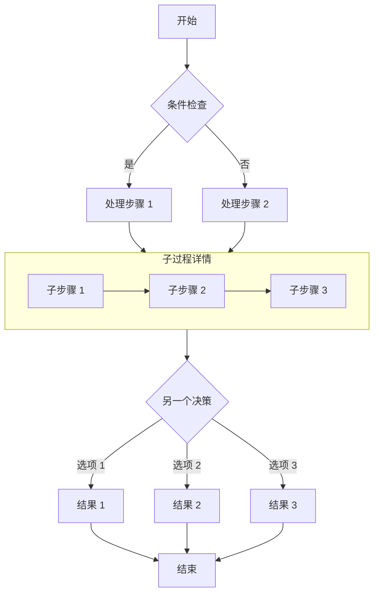

#### 时序图

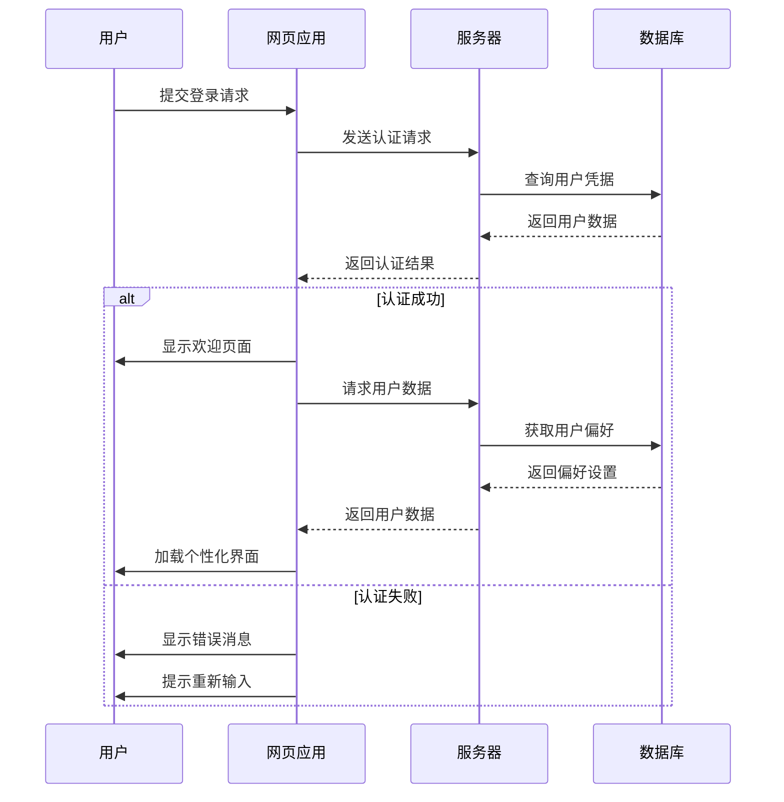

#### ER 图

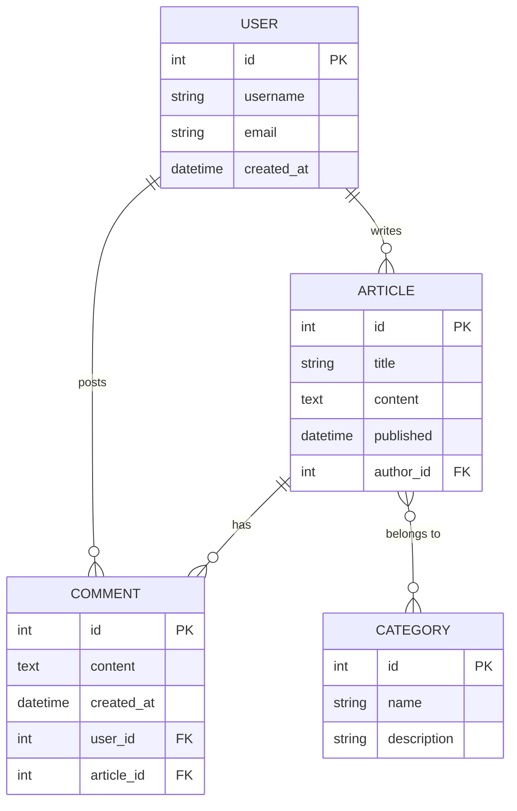

#### 类图

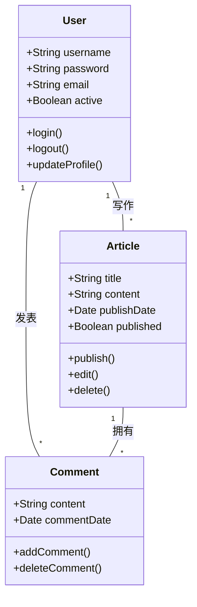

#### 状态图

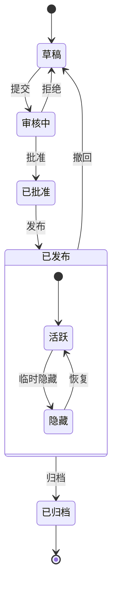

#### XY 图

```mermaid
xychart-beta
    title "月度访问量趋势"
    x-axis [1月, 2月, 3月, 4月, 5月, 6月]
    y-axis "访问量" 0 --> 5000
    bar [2500, 3200, 4100, 3800, 4500, 4800]
    line [2500, 3200, 4100, 3800, 4500, 4800]
```

#### 饼图

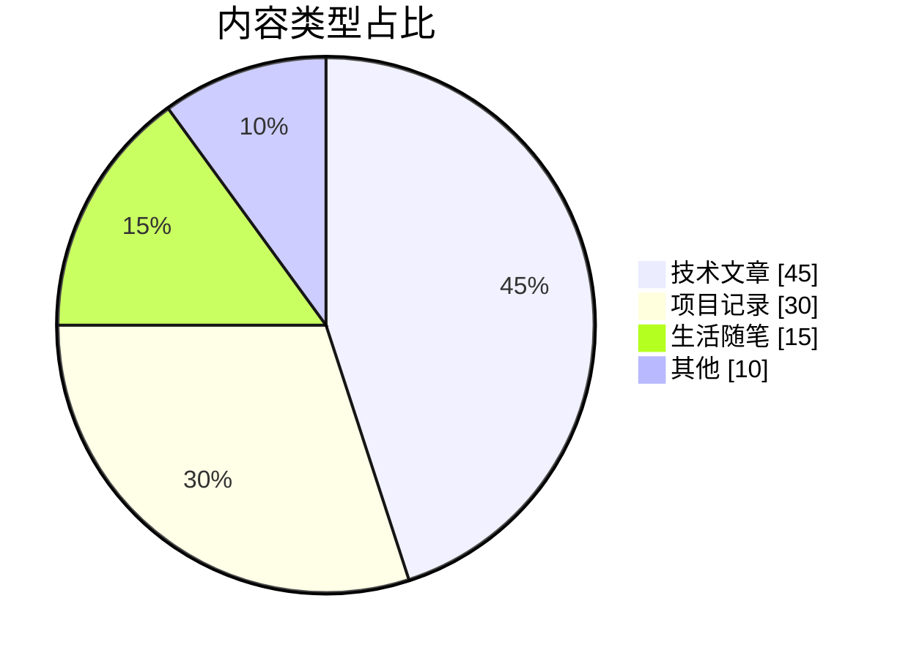

#### 甘特图

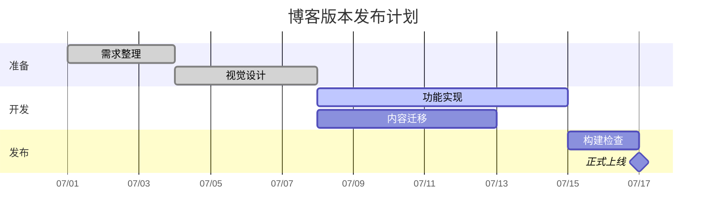

#### 思维导图

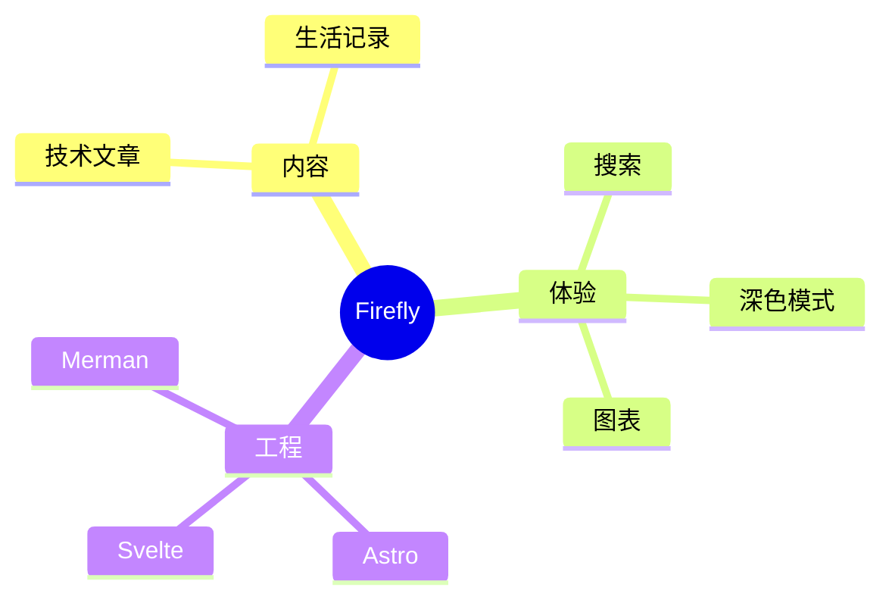

#### 时间线

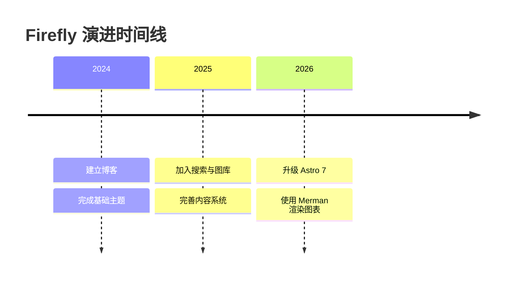

#### Git 图

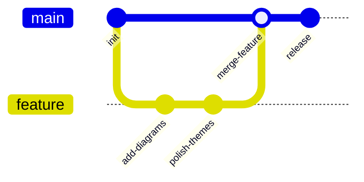

#### 看板


#### Sankey 图

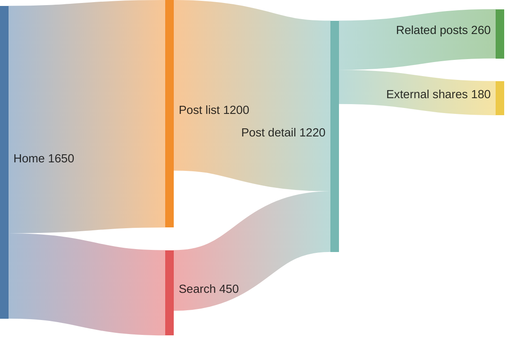

Mermaid 是在 Markdown 文档中创建各种类型图表的强大工具。要使用 Mermaid，只需在代码块中指定 mermaid 语言，并使用简洁的文本语法描述图表。图表会在构建时自动渲染为 SVG，无需客户端 JavaScript 加载。

---

### 3.4 PlantUML 图表

PlantUML 是一种使用纯文本描述图表的工具。你只需要写一段结构化语法，就可以生成时序图、类图、用例图、活动图等常见工程图。

在 Firefly 中，`plantuml` 代码块会在构建阶段编码并生成服务器 SVG 地址，页面端再根据亮暗主题自动切换图源，并支持缩放、拖拽和全屏交互。

最小模板：

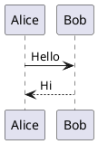

#### 活动图

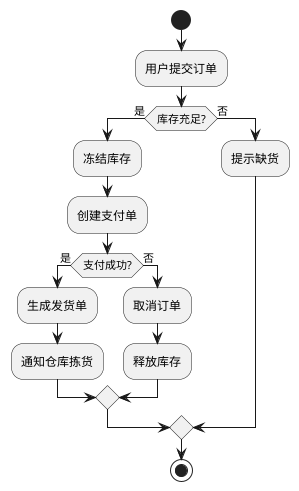

#### 状态图

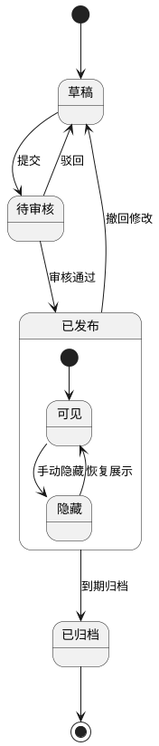

#### 用例图

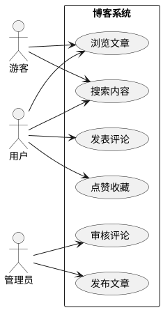

#### ER 图

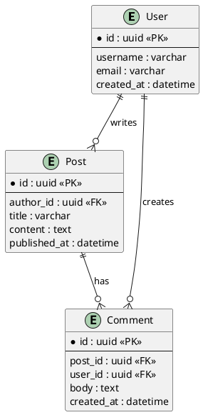

#### 时序图（登录与刷新令牌）

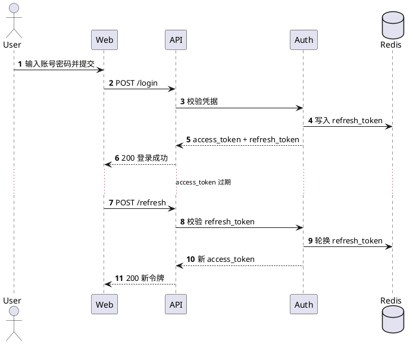

---

### 3.5 KaTeX 数学公式

Firefly 支持 KaTeX 数学公式渲染。

#### 行内公式 (Inline)

行内公式使用单个 `$` 符号包裹。

例如：欧拉公式 $e^{i\pi} + 1 = 0$ 是数学中最优美的公式之一。

质能方程 $E = mc^2$ 也是家喻户晓。

#### 块级公式 (Block)

块级公式使用两个 `$$` 符号包裹，会居中显示。

$$
\int_{-\infty}^{\infty} e^{-x^2} dx = \sqrt{\pi}
$$

$$
x = \frac{-b \pm \sqrt{b^2 - 4ac}}{2a}
$$

#### 矩阵 (Matrices)

$$
\begin{pmatrix}
a & b \\
c & d
\end{pmatrix}
\begin{pmatrix}
\alpha & \beta \\
\gamma & \delta
\end{pmatrix} =
\begin{pmatrix}
a\alpha + b\gamma & a\beta + b\delta \\
c\alpha + d\gamma & c\beta + d\delta
\end{pmatrix}
$$

#### 极限与求和

$$
\sum_{n=1}^{\infty} \frac{1}{n^2} = \frac{\pi^2}{6}
$$

$$
\lim_{x \to 0} \frac{\sin x}{x} = 1
$$

#### 麦克斯韦方程组

$$
\begin{aligned}
\nabla \cdot \mathbf{E} &= \frac{\rho}{\varepsilon_0} \\
\nabla \cdot \mathbf{B} &= 0 \\
\nabla \times \mathbf{E} &= -\frac{\partial \mathbf{B}}{\partial t} \\
\nabla \times \mathbf{B} &= \mu_0\mathbf{J} + \mu_0\varepsilon_0\frac{\partial \mathbf{E}}{\partial t}
\end{aligned}
$$

#### 化学方程式

$$
\ce{CH4 + 2O2 -> CO2 + 2H2O}
$$

#### 符号速查表

| 符号 | 代码 | 渲染结果 |
| :--- | :--- | :--- |
| Alpha | `\alpha` | $\alpha$ |
| Beta | `\beta` | $\beta$ |
| Gamma | `\Gamma` | $\Gamma$ |
| Pi | `\pi` | $\pi$ |
| Infinity | `\infty` | $\infty$ |
| Right Arrow | `\rightarrow` | $\rightarrow$ |
| Partial | `\partial` | $\partial$ |

更多 KaTeX 语法请参考 [KaTeX Supported Functions](https://katex.org/docs/supported.html)。

---

### 3.6 MDX 格式

> [!TIP]
> Firefly 支持 `MDX` 和 `Markdown` 两种类型的文章，你可以在文章中混合使用两种格式，如果没有特别复杂内容和需求，推荐使用 Markdown 格式就够了。

#### Markdown 和 MDX 的区别

- Markdown (MD) 是一种轻量级标记语言，允许用户使用纯文本格式编写文档，然后将其转换为格式化的HTML。它因其简洁易用的语法而广受欢迎，特别适合编写文档和博客文章。
- MDX 是一种扩展了 Markdown 语法的格式，允许在 Markdown 文档中无缝地插入 JSX 代码。通过 MDX，用户可以在文档中嵌入 React 组件，从而实现更丰富的交互性和动态性。

| 特性 | Markdown | MDX |
| :--- | :--- | :--- |
| 基础语法 | 支持 (CommonMark) | 支持 (CommonMark) |
| HTML 标签 | 支持 | 支持 (作为 JSX) |
| 组件导入 | 不支持 | 支持 (import) |
| 动态数据 | 不支持 | 支持 (JS 表达式) |
| 样式定制 | 有限 (class/style) | 灵活 (className/CSS-in-JS) |

#### 使用组件

```mdx
import { Icon } from 'astro-icon/components'

<div class="flex items-center gap-2 my-4">
  <Icon name="fa7-solid:rocket" class="text-4xl text-red-500" />
  <span>火箭发射！</span>
</div>
```

#### 使用 JSX 与表达式

```mdx
<div className="p-4 bg-blue-100 dark:bg-blue-900 rounded-lg my-4">
  这是一个自定义样式的 div 块，使用了 Tailwind CSS 类。
</div>

export const year = new Date().getFullYear()
今年是 {year} 年。
```

更多信息，请查看 [MDX 文档](https://mdxjs.com/)。

---

### 3.7 Wiki Link 内部链接

Firefly 支持在 Markdown、MDX 文章中使用 Obsidian 风格的 Wiki Link 内部链接。链接目标填写文章的 slug 或文件路径，都不需要包含扩展名。

#### 文章链接卡片

`[[slug]]` 单独成段时，会自动读取目标文章的标题、描述、发布时间、分类、标签和封面，渲染为链接卡片：

```markdown
[[firefly-guide]]
```

[[firefly-guide]]

#### 行内链接

`[[slug]]` 出现在正文中间时，渲染为普通链接，链接文字自动使用目标文章的标题：

```markdown
请参阅 [[firefly-guide]] 了解完整指南。
```

#### 自定义显示标题

在 `|` 后填写链接的显示文字：

```markdown
请参阅 [[firefly-guide|本指南]] 了解详情。
```

#### 链接目标的三种写法

链接目标按以下顺序匹配：

| 写法 | 示例 | 说明 |
|---|---|---|
| frontmatter 的 `slug` | `[[firefly-guide]]` | 优先匹配 |
| 文件路径（相对仓库根目录） | `[[guide/firefly-layout-system]]` | 推荐，Obsidian 兼容 |
| 裸文件名（仓库内唯一时） | `[[firefly-layout-system]]` | Obsidian 默认 |

> [!TIP]
> 推荐修改 Obsidian 内部链接类型设置为**基于仓库根目录的绝对路径**，一劳永逸。

#### 链接到其他文章的标题

在文章 slug 后添加 `#标题`。带标题锚点的链接始终渲染为普通链接：

```markdown
[[firefly-guide#Mermaid 图表|查看 Mermaid 图表用法]]
```

#### 链接到本页标题

省略文章 slug，只填写标题即可链接到当前文章：

```markdown
[[#目标标题|跳转]]
```

---

### 3.8 文章加密

Firefly 支持文章内容加密。设置 frontmatter 中的 `password` 字段即可启用。

```yaml
---
title: 加密文章
published: 2023-09-09
password: "123456"
passwordHint: "示例文章密码123456"
---
```

**功能说明**

- **构建时加密**：文章内容在构建时使用 AES-256-GCM 算法加密，页面源码中不包含任何明文。
- **客户端解密**：访客输入正确密码后，浏览器通过 Web Crypto API 在本地完成解密。
- **会话缓存**：同一浏览器会话内，密码会被缓存到 `sessionStorage`，刷新页面无需重复输入。
- **关闭即失效**：关闭浏览器后缓存清除，再次访问需要重新输入密码。

---

### 3.9 嵌入视频

只需从 YouTube 或其他平台复制嵌入代码，然后将其粘贴到 markdown 文件中。

#### YouTube

```markdown
<iframe width="100%" height="468" src="https://www.youtube.com/embed/5gIf0_xpFPI" title="YouTube video player" frameborder="0" allowfullscreen></iframe>
```

#### Bilibili

```markdown
<iframe width="100%" height="468" src="//player.bilibili.com/player.html?bvid=BV1fK4y1s7Qf&p=1&autoplay=0" scrolling="no" border="0" frameborder="no" allowfullscreen="true"></iframe>
```

---

## 第四部分：布局与配置

### 4.1 布局系统详解

Firefly 提供了灵活的布局系统，允许您根据内容需求和个人喜好自定义博客的视觉呈现方式。布局系统主要包括**侧边栏布局**和**文章列表布局**两个维度。

[grid]


[/grid]

[grid]


[/grid]

#### 侧边栏布局系统

**单侧边栏模式**

特点：
- 侧边栏固定在页面其中一侧（`position: "left"` 或 `position: "right"`）
- 文章阅读区域体验更佳，更宽敞
- 更加简约

```typescript
// src/config/sidebarConfig.ts
export const sidebarLayoutConfig: SidebarLayoutConfig = {
  enable: true,
  position: "left", // 左侧边栏
  showBothSidebarsOnPostPage: true, // 文章页显示双侧边栏
};
```

**双侧边栏模式 (`position: "both"`)**

特点：
- 左右两侧同时存在侧边栏
- 主内容区域位于中间
- 最大化利用屏幕空间
- 适合宽屏显示器

```typescript
export const sidebarLayoutConfig: SidebarLayoutConfig = {
  enable: true,
  position: "both",
};
```

#### 文章列表布局系统

**列表模式 (`defaultMode: "list"`)**

- 单列纵向排列
- 显示文章封面图
- 展示更多文章摘要

**网格模式 (`defaultMode: "grid"`)**

- 自适应列数，根据浏览器宽度自动调整
- 紧凑布局，信息密度高
- 通过 `columnWidth` 配置卡片的最小宽度（单位 px）

```typescript
// src/config/siteConfig.ts
export const siteConfig: SiteConfig = {
  postListLayout: {
    defaultMode: "grid",
    grid: {
      masonry: true,      // 开启瀑布流
      columnWidth: 320,   // 卡片最小宽度(px)
    },
  },
};
```

**瀑布流布局 (Masonry)**

Firefly 的网格模式内置了智能瀑布流布局支持：
- **智能排版**：自动将卡片放置到最短的列，最大化利用垂直空间
- **消除空白**：通过绝对定位精确计算每个卡片的位置
- **自适应列数**：根据 `columnWidth` 和容器宽度动态计算列数

#### 布局组合推荐

| 侧边栏模式 | 文章列表模式 | 推荐度 | 适用场景 |
|-----------|------------|--------|---------|
| 单侧边栏 | 列表模式 | ⭐⭐⭐⭐⭐ | 摄影、设计、生活类博客 |
| 单侧边栏 | 网格模式 | ⭐⭐⭐⭐⭐ | 技术、笔记类博客 |
| 双侧边栏 | 列表模式 | ⭐⭐⭐⭐⭐ | 需要展示大量侧边栏信息的站点 |
| 双侧边栏 | 网格模式 | ⭐⭐⭐⭐⭐ | 极客风格，追求最高信息密度 |

#### 响应式布局行为

1. **网格列数自动减少**：网格模式的列数由 `columnWidth` 和容器宽度自动决定
2. **列表模式 -> 网格模式**：当屏幕宽度小于 380px 时，列表模式会自动切换为网格模式
3. **双侧边栏 -> 单侧边栏**：当屏幕宽度小于 1280px 时，会根据 `tabletSidebar` 配置显示单侧边栏

---

## 相关链接

- [Firefly 官方文档](https://docs-firefly.cuteleaf.cn/)
- [Firefly GitHub](https://github.com/CuteLeaf/Firefly)
- [Astro 文档](https://docs.astro.build/)
- [Expressive Code 文档](https://expressive-code.com/)
- [Merman Playground](http://frankorz.com/merman/)
- [KaTeX 支持函数](https://katex.org/docs/supported.html)
- [MDX 文档](https://mdxjs.com/)
